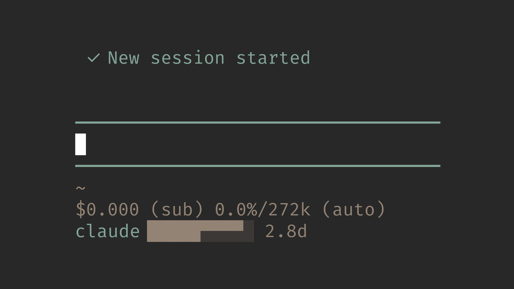

# pi-claude-usage

> Pi extension for Anthropic Claude subscription usage state and optional Fast mode



This extension owns **usage state + usage mode**: zero-configuration quota reporting and an optional per-model Fast preference. Shared command arbitration/JSONC editing belong to [`@llblab/pi-command-fast`](https://github.com/llblab/pi-command-fast), a normal library dependency, not another Pi extension.

This repository is an adaptation of [`pi-codex-usage`](https://github.com/llblab/pi-codex-usage) for Anthropic Claude Pro/Max subscriptions. It keeps the statusline design, but reads quota from the Anthropic OAuth usage endpoint using Pi's own Anthropic login.

## Start Here

- [Agent Notes](./AGENTS.md)
- [Backlog](./BACKLOG.md)
- [Changelog](./CHANGELOG.md)

## Features

- Shows two counter-moving half-height markers in the statusline bar while quota is loading, then keeps the bar fresh (the countdown ticks locally)
- Keeps the last usable bar visible during ordinary refreshes instead of replacing known quota with a loading state
- Immediately rounds one likely exhausted near-empty window to zero on the specific native Anthropic subscription account-limit error, without making an extra quota request
- Dual bar: the top half shows the 5-hour session window and the bottom half shows the 7-day window, 20 steps (5% each) per window
- If only one window is returned, shows its remaining percentage and reset countdown instead of a bar
- Shown only while the active model uses the Pi `anthropic` provider
- When `pi-telegram` is available, the same compact value appears as `claude: <value>` in the `/start` menu status text
- Missing OAuth auth, API-key-only auth, or missing quota windows are shown as `n/a`, not as an error
- Network/provider failures keep the last good bar, then show `error` after repeated failures
- Any number of Pi instances share one request stream, see [Shared Refresh](#shared-refresh)
- No commands or configuration are required for quota display; the optional shared `/fast` toggles native request speed

## Install

Requires Pi ≥1.0.0 for the native beta-preserving Fast bridge. Older Pi (including 0.84.2) assembles Anthropic headers differently and is not supported by this release.

From npm:

```bash
pi install npm:@llblab/pi-claude-usage
```

From git:

```bash
pi install git:github.com/llblab/pi-claude-usage
```

## Development

The shared `@llblab/pi-command-fast@^0.1.0` dependency now resolves from npm; no sibling library checkout is required.

```bash
npm ci
npm run validate
```

For explicitly local library experiments, a temporary folder link reads the library's built `dist/`, not TypeScript source directly. Rebuild after source edits and restore the registry dependency/lock before publishing; see [Backlog](./BACKLOG.md).

## Fast mode

`/fast` takes no arguments and dispatches by the current **provider**. This consumer permits Fast for the **Opus family** (`claude-opus-` model IDs), without pinning versions. Sonnet, Haiku, Fable, Mythos and other families receive `Fast mode is supported only for Opus` without config writes or quota requests. Family eligibility does not guarantee backend support: older or otherwise unsupported Opus versions can still receive an API rejection. For eligible models it persists only the following model override in Pi's canonical `models.json` (honoring `PI_CODING_AGENT_DIR`):

```json
{
  "providers": {
    "anthropic": {
      "modelOverrides": {
        "your-current-model": { "speed": "fast" }
      }
    }
  }
}
```

OFF deletes only `speed`; there is no normal/default sentinel or separate Fast config. JSONC comments, unrelated fields and other providers/models survive. State follows the selected model and restart; manual edits are reread on lifecycle refresh and every request. Stale `speed: "fast"` overrides on unsupported models do not enable the suffix or this extension's request bridge; they are preserved, not silently deleted. Remove such a stale property manually if needed.

When Claude Usage and Codex Usage are loaded together, their shared library registers **one** `/fast` in either load order, across separate physical library copies. Its WeakMap is keyed by session manager; shutdown releases registrations because Pi reload reuses that identity. Unrelated providers receive a concise unsupported-provider message; invalid arguments show `Usage: /fast`. Successful toggles are silent and immediately redraw the existing terminal status without a quota request:

```text
claude ██████▀▀▀▀ 6d fast
```

Exactly lowercase ` fast` uses the existing dim/countdown role at the final terminal presentation boundary, including loading, single-window percentages, `n/a` and errors. Telegram also appends plain-text ` fast` for the active eligible model; quota OAuth, polling, mutex, fencing and backoff are unchanged.

Native request adaptation adds `speed: "fast"` without overwriting an explicit speed. It adds `fast-mode-2026-02-01` to Pi's already-assembled request `betas`, preserving automatic OAuth/thinking/streaming and configured betas; the Anthropic SDK converts that list to the final `anthropic-beta` HTTP header. Setting a replacement header earlier would suppress Pi's automatic betas, so no header replacement or custom provider/transport is used. See [Anthropic Fast mode](https://platform.claude.com/docs/en/build-with-claude/fast-mode).

Pi 1.0.0 accepts the extra override but does not propagate `speed` to native request options, so the bridge is necessary. There is no public command unregister/conditional-visibility API: `/fast` stays listed and checks the provider and consumer model capability when invoked. A stored preference/suffix is intent, not evidence that the backend served Fast. Anthropic also requires Fast usage credits and organization-level permission; a supported model can still be rejected (for example, `429 credits_required` with `org_level_disabled`). The extension never enables billing or buys credits.

## Statusline

```text
claude ██████▀▀▀▀ 6d
```

The ten-character bar encodes two twenty-step limits at once: the top quadrants show the remaining 5-hour limit and the bottom quadrants show the remaining weekly limit. When either window's remaining percentage rounds to `0%`, that half becomes completely empty and the entire dual bar switches to the error background color; the other half still shows its remaining quota.

When the weekly reset time is available, it follows the bar. More than a day remains is shown in 144-minute day-tenth steps such as `7d`, `6.9d`, `1.1d`, rounded upward. At 24 hours and below it switches to upward-rounded hour-tenths such as `24h`, `23.7h`, `1.1h`, `1h`. Under an hour it shows floored minutes, then seconds. After the reset passes, `0s` is held until the next successful refresh.

When the 5-hour window is exhausted and exposes its reset time, the statusline adds it before the weekly reset:

```text
claude ▄▄▄▄▄⠀⠀⠀⠀⠀ 5h/7d
```

If only one window is returned, the remaining percentage rounded to the nearest integer is shown:

```text
claude 67% 7d
```

Unavailable (no Anthropic subscription auth):

```text
claude n/a
```

Runtime failure, such as a network or provider error (including rate limiting of the usage endpoint):

```text
claude error
```

## Passive Model-Limit Signal

For the native `anthropic` provider, Claude model IDs using `anthropic-messages` at `https://api.anthropic.com` with Pi OAuth auth, the extension also observes failed assistant messages. It recognizes HTTP 429 with a JSON error envelope whose `type` is `error`, `error.type` is `rate_limit_error`, and `error.message` is exactly `This request would exceed your account's rate limit. Please try again later.` (ignoring whitespace differences). API-key models, proxies, other providers, generic throttling, Fast credit errors and errors from the usage endpoint do not trigger it.

On this signal, at most one cached window with **strictly less than 5% remaining** is immediately displayed as zero. If only one window is near-empty, it is selected; a sole near-empty weekly window also qualifies. If both windows are near-empty, compare the five-hour remaining percentage with **six times the weekly remaining percentage** and select the smaller balance, preferring the five-hour window on ties. This uses an empirical estimate that one weekly budget is approximately six full five-hour budgets, not an official Anthropic quota guarantee. For example, 2% five-hour versus 1% weekly selects five-hour (2 versus 6), while 4% five-hour versus 0.5% weekly selects weekly (4 versus 3). Exactly 5% and larger balances are unchanged. If either measured window is already exhausted, the other window is not additionally zeroed. Existing exhausted-window colors and reset countdowns are reused.

This is a display inference, not an authoritative quota measurement: the error itself does not identify the exhausted window. The measured `report` and `updatedAt` remain unchanged. A separate `modelRateLimitedAt` marker is shared under the existing mutex without changing ownership, the lease, or retry deadlines. The receiving instance redraws immediately; other instances pick it up on their normal file-read ticks (within 30 seconds). A successful quota refresh started after the signal clears it; an already-in-flight response or another failure cannot erase it. No extra quota request is made, and Pi's model retry behavior is unchanged.

## Shared Refresh

The extension ships an export-only [`index.ts`](./index.ts) and a flat domain DAG under `lib/`, matching Codex Usage's layout. [`extension.ts`](./lib/extension.ts) composes lifecycle/Fast wiring; [`status.ts`](./lib/status.ts) orchestrates refresh and redraw; [`usage-store.ts`](./lib/usage-store.ts) owns shared claims/fencing/mutex; [`query.ts`](./lib/query.ts) owns OAuth/HTTP; [`usage.ts`](./lib/usage.ts) normalizes quotas; [`model-limit.ts`](./lib/model-limit.ts) recognizes the narrow passive model-error signal and derives near-empty window overrides; [`status-format.ts`](./lib/status-format.ts) formats values; [`telegram.ts`](./lib/telegram.ts) owns optional registration; [`fast.ts`](./lib/fast.ts) adapts native Fast requests. Domains never import the entrypoint, and tests are organized by domain in `tests/`.

To avoid independent polling, instances coordinate through `~/.pi/agent/tmp/pi-claude-usage/usage.json` (percentages and timestamps only, no tokens):

- The instance that last updated the file is the leader and refreshes it every 2 minutes
- Every other instance only reads the file (re-checking every ≤30s) and redraws when it changes
- Leadership is never cached in memory: before each usage request, the instance re-reads the file and checks its `owner`, unique `claimId`, and 150s lease. Publication rechecks that claim under the lock; a superseded success or failure is discarded. Failed locks or unwritten claims never authorize a request
- If the file is 150 seconds old (leader is closed, busy, or asleep), the first follower that obtains the mutex takes over: it re-reads the JSON, writes itself as the leader with a fresh timestamp, releases the mutex, then fetches from the server and publishes under the mutex after rechecking its claim. Its next refresh is two minutes later; JSON writes remain atomic renames
- Claiming and publication use a non-waiting transaction in `mutex.sqlite`, through Node's built-in `node:sqlite` (Node ≥22.19.0, the existing package minimum). It stores no quota or leadership records and needs no extra package or service. The OS releases the lock when the connection closes or the process dies; there is no timeout-based lock stealing
- Failures are written to the file with an exponential backoff (1 to 5 minutes; 5 to 30 minutes for HTTP 429) that applies to all instances
- The last report stays visible for up to an hour; after that `error` is shown

Coordination assumes a local filesystem and cooperating instances on the same machine. Never delete or replace `mutex.sqlite` while instances are running. Network requests do not hold the mutex; a process paused inside a short critical section keeps it until it resumes or exits, so other writers retry later without blocking the TUI. This preserves exclusion instead of stealing a live lock.

**Upgrade:** Close all old instances before starting updated ones. The legacy `lock` files are ignored; old and new locking protocols must not run together. Cached `usage.json` data needs no migration. Restart all instances after updating so none retain an older polling interval or ignore the passive model-limit signal.

## Telegram Status Menu

If `@llblab/pi-telegram` is loaded with the public status-line provider API, this extension registers an optional `/start` menu status row while the active model uses the Anthropic provider:

```text
claude: ██████▀▀▀▀ 6d
```

When Fast is enabled for the active Opus model, the row appends plain-text ` fast`; without a usable quota report it shows `claude: fast`. The preference is reread when the menu is rendered, so toggles and model changes do not depend on a quota refresh. Unsupported Claude families never show Fast, even with stale overrides.

If `pi-telegram` is absent or older, or the active model is not Anthropic, no Telegram row is added.

## Auth

The extension uses the OAuth token of Pi's `anthropic` provider (`/login` → Anthropic Claude Pro/Max) and calls `GET https://api.anthropic.com/api/oauth/usage` with the `anthropic-beta: oauth-2025-04-20` header. Pi refreshes the token as needed. Anthropic API keys are not subscription auth and do not expose these quotas.

## License

MIT. See [`LICENSE`](./LICENSE).
